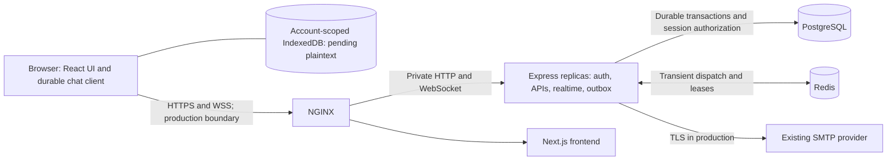
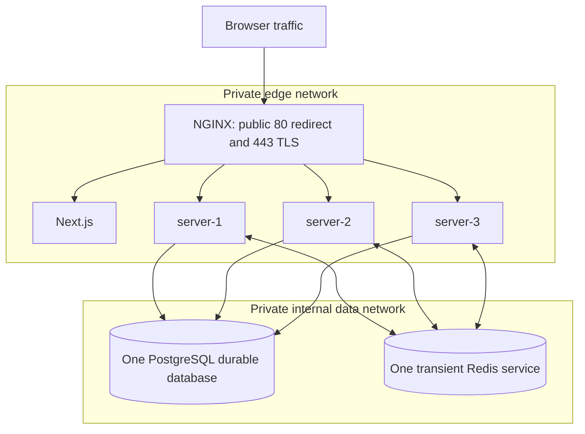

# Recovery boundaries and release decisions

Status: architecture of the implemented first release, including owner-approved Task 3 policies and Task 34 records. Local correctness, capacity and recovery evidence is linked below; public production deployment, real-browser and full-size backup qualification remain open.

## Durable and transient ownership

PostgreSQL owns users, sessions, direct participant pairs, messages, conversation sequence counters and delivery-outbox rows. A transaction commits the message, counter and outbox before accepting a send. The `(sender_id, client_message_id)` unique key resolves retries to one canonical message; changed content/destination is a conflict. Each conversation's row lock allocates commit-ordered sequence numbers. Redis/Socket.IO carries live notifications, not durable offline storage. Clients recover from PostgreSQL and advance only through applied contiguous sequences. An instance crash can replay publication, so visible effects must deduplicate.

The first release uses TLS and server-readable text. `encryptedPayload` is the legacy property name for the exact stored string, not cryptography. No schema rewrite or new envelope is selected. Existing opaque records are retained; the UI must not claim undecoded opaque data is readable history. Authenticated simultaneous devices remain supported without cryptographic linking.

## Approved retention and recovery window

Retain message and identity records until an explicit approved deletion process. No scheduled purge is authorized. Catch-up covers retained canonical history regardless of elapsed offline time; this is not an infinite storage/availability commitment. Backend pages remain bounded and a large history must be consumed incrementally. Presence/typing are transient and must not be replayed as messages.

Any later retention/deletion design must separately specify how sequence positions, message identity and idempotency survive. Do not hard-delete a message and leave a sequence hole that the current client will retry forever. A deletion feature is outside this work; implementation would need an explicit compatible tombstone or reset protocol before enabling deletion.

## Recovery contract: current behavior and required changes

All recovery operations require the current session and participant authorization. Missing and unauthorized conversations share 404; malformed IDs/cursors/limits return 400 without disclosing history. Sequences are decimal bigint strings, `after` is exclusive and the current server caps `limit` at 100.

| Situation | Current implementation | Required release behavior |
| --- | --- | --- |
| New browser, no checkpoint | The UI bootstraps a bounded recent page, then synchronizes from its snapshot head; direct clients can also begin at `after=0`. | The API and UI support a bounded recent window, older pages and snapshot-head catch-up. |
| Long-offline browser | All stored sequences after a valid cursor can be paged; no purge exists. | Recover all retained history with no time expiry, gaps or duplicate visible effects. Network/storage faults remain retryable. |
| Cursor equals head | Empty page, `nextAfter: null`. | Successful catch-up only after authoritative validation; retain the applied cursor. |
| Malformed or out-of-bigint-range cursor | Shared schema rejects it, controller returns 400. | Preserve this behavior and prove it in integration tests. |
| Valid decimal cursor ahead of head | Server returns 409 `CURSOR_AHEAD`; the history UI offers explicit reload while preserving pending sends. | Return 409 with stable code `CURSOR_AHEAD`; do not advance/reset silently or report synchronized. Offer explicit history rebuild preserving pending sends. |
| A required sequence is missing or declared unavailable | Server returns 410 `HISTORY_UNAVAILABLE` for missing boundaries or required page gaps; the history UI offers explicit reload while preserving pending sends. | Return 410 with stable code `HISTORY_UNAVAILABLE` for a known unavailable range; fail synchronization visibly and rebuild from a declared valid boundary. Do not introduce age-based expiry under this retention policy. |
| Database restored to an earlier snapshot | The database generation is rotated after restore; missing or mismatched generations fail closed. Accepted messages newer than the backup can be absent. | Invalidate all pre-restore checkpoints, including numerically valid ones. Use a restoration generation/reset mechanism or equivalent proven full-client invalidation; old clients must not merge incompatible histories. Preserve pending sends for explicit reconciliation. |

The 409/410 responses, generation invalidation and explicit client reset are implemented. See [the operator restore procedure](operations.md). Do not classify a temporary database outage as permanent history loss. Validation of a paging boundary must use a consistent snapshot/head or equivalent atomic query so a concurrent send cannot produce a false ahead-of-head verdict. A reset must require current authorization and cannot expose a different account's history.

Recent requests use `recent=true`; older requests use an exclusive positive `before` sequence. All pages return messages in ascending sequence order and the snapshot `headSequence`. Recent/older pages expose `nextBefore`; after pages retain `nextAfter`. Apply the recent window before starting catch-up from its head; older pages do not move this checkpoint. Repeatable-read transactions bound queries to the same authorized head, and the existing `(conversation_id, sequence)` index supports both scan directions. Gap detection covers the requested page and its lookahead, not an unbounded audit of earlier history.

## Backup disaster boundary

Approved targets: daily encrypted database backups; retain backups seven days; RPO <=24 hours; RTO <=4 hours. RPO is the maximum targeted loss measured to the last recoverable backup, not a guarantee of zero loss. RTO covers restoration, readiness and required verification, not merely starting PostgreSQL. Encrypted backup/restore tooling and an isolated fixture rehearsal are implemented. Production scheduling/off-host storage and production-size RPO/RTO qualification remain open; the fixture duration is not a production RTO.

The no-loss guarantee for one application instance failing assumes shared storage remains available. Database destruction/restore is a different scenario and can lose acknowledged messages after the backup cutoff. Clients must not silently re-create previously accepted history with new identities or claim the lost range was delivered. Pending unsatisfied sends retain their original client IDs and content; already-accepted local history must be reconciled against the restored service, with any loss disclosed.

## Task 3 verification walkthrough

1. **New device:** authenticate/verify, open an authorized conversation, bootstrap retained history, join live updates and render each canonical message once. Recent bootstrap/older paging is implemented in the API; the browser applies a bounded recent window before starting live catch-up.
2. **Long-offline device:** replay exclusive of its last applied valid sequence over retained history; do not expire merely because it is old. Detect gaps and do not report successful catch-up until reconciled.
3. **Future cursor:** syntax can be valid while exceeding the stored head. Required 409 `CURSOR_AHEAD` leads to explicit rebuild with the pending outbox preserved. Server enforcement is implemented; the client offers an explicit recent-history reload.
4. **Restored database:** use a new recovery generation or equivalent proven invalidation, reject old checkpoints, disclose the restore cutoff, rebuild from canonical history and reconcile pending sends without claiming recovery beyond the backup. Generation rotation rejects stale open and returning clients; Task 26 measures full backup restoration.

These walkthroughs verify that each case has a defined expected outcome. They are not runtime test evidence. Script evidence for Tasks 3A–3C is recorded in the test report; production restore rehearsal remains Task 26.

Nonzero checkpoints and older boundaries require the original UUID `generation`; absent or mismatched generations return 409 `HISTORY_RESET` after participant authorization. A fresh `recent=true` or `after=0` response returns the current generation. Updated clients retain it alongside applied history and send `X-History-Generation` on writes; stale writes fail before acceptance. Realtime readiness/delivery carries the same generation. Follow the fenced restore/rotation procedure; SQL rotation alone does not safely replace a live database.


## Component and trust boundaries



The browser is untrusted. Cookies authenticate; all participants, sender identity
and activity peers are derived server-side. The private gateway supplies source
IP identity. Production examples expose only gateway ports; direct backend,
PostgreSQL, Redis and metrics access must be blocked externally. Operators with
database/browser-profile/host access can read server/local plaintext as documented.

## Message data flow

```mermaid
sequenceDiagram
    participant C as Sender client
    participant A as Accepting replica
    participant D as PostgreSQL
    participant W as Outbox worker
    participant R as Redis and other replicas
    participant P as Recipient client
    C->>C: Persist logical ID, text and generation
    C->>A: Authenticated POST with original ID
    A->>D: Lock conversation; insert message, counter, outbox
    D-->>A: Commit canonical message
    A-->>C: 201 new or 200 identical retry
    W->>D: Claim pending outbox row; SKIP LOCKED
    W->>R: Dispatch to authorized local sockets on each replica
    R-->>P: message:created plus generation
    R-->>W: Routing acknowledgement, not recipient receipt
    W->>D: Mark published and commit
    P->>P: Merge contiguous sequence; catch up on gaps
```

The worker also delivers to its own local sockets. Redis/pub-sub notifications
can be lost or repeated; canonical history remains in PostgreSQL. Outbox ordering
is not a promise of global or per-socket event order: conversation sequences and
client catch-up provide that order. No ordering is defined across conversations.

## Three-replica deployment



This is the implemented Docker-host template, not a claim that production is
running. Local Compose uses loopback HTTP and a local test mailbox. Replicas use
ten-connection PostgreSQL pools (30 total plus operations/migrations), two Redis
connections each, bounded outbox work and readiness/draining gates. Shared
PostgreSQL/Redis and one Docker host remain availability boundaries; no database
HA, multi-region system or distributed backup service is implied.

## Failure walkthroughs and evidence

| Trigger | Ownership and recovery | Evidence |
| --- | --- | --- |
| Lost live notification | Committed message/outbox remains; reconnect or periodic catch-up reads canonical history and suppresses duplicates. | Message/realtime/client-sync scripts; ADRs 001/004. |
| Lost HTTP acknowledgement | Client retains original ID/body; another replica returns the identical canonical response. | Retry/conflict tests, uncertain-send load probe. |
| Abrupt replica death | Other replicas continue; reconnect selects a healthy server, catches up and completes send/receive; dead final activity leases expire. | Task 32: worst 1.12 s baseline / 8.45 s upper; presence <=22.01 s, typing <=5.43 s in measured local profiles. |
| Redis outage | HTTP persistence/history stay available; publication remains pending; activity is unavailable; recovery requests catch-up and rebuilds leases. | Dependency/activity/realtime fault scripts. |
| PostgreSQL outage | HTTP readiness fails, no false acceptance, checked-out/idle errors are handled, clients retain retry identity and resume. | Dependency-outage script and Task 27 connection-error fix. |
| Database restore | Fence old writers, restore consistently, rotate generation, reject old checkpoints and review old-generation queues. | Isolated Task 26 restore; production-sized recovery still open. |

Architecture decisions: [routing](adr/001-routing.md), [presence](adr/002-presence.md),
[load balancing](adr/003-load-balancing.md), [synchronization](adr/004-synchronization.md).
See [correctness coverage](correctness-coverage.md), [load/recovery evidence](load-recovery-report.md),
[security review](security-review.md) and [operations](operations.md) for the limits
of these claims. TLS/server-readable text is the approved release scope; E2EE,
read receipts, purge/deletion and cryptographic device recovery are excluded.
